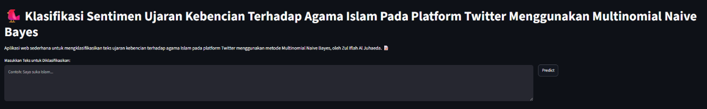

# KlasifikasiSentimenTwitter — Hate Speech Detection Against Islam on Twitter

Multinomial Naive Bayes classifier detecting hate speech directed at Islam in Indonesian-language tweets, with a lexicon-based augmentation step, systematic alpha tuning, and k-fold cross-validation. Basis for a peer-reviewed publication.

[](https://www.python.org/)
[](https://scikit-learn.org/)
[](https://streamlit.io/)
[](LICENSE)



## Overview

**Problem.** Automatically flagging hate speech against religious groups on social media is a narrow, high-stakes text classification task: the signal is sparse (most tweets aren't hate speech), the language is informal Indonesian Twitter text, and a false negative (missing real hate speech) is more costly than a false positive.

**Approach.**

1. Collected and labeled ~1,200 Indonesian-language tweets as **Negatif** (no hate speech) or **Positif** (hate speech present).
2. Preprocessed text: URL/mention/hashtag stripping, case folding, tokenization, Indonesian stopword removal, stemming.
3. Augmented the model with a **positive/negative sentiment lexicon** (`lexicon/positive.tsv`, `lexicon/negative.tsv`) alongside the Bag-of-Words features.
4. Vectorized with `CountVectorizer` and trained **Multinomial Naive Bayes**, systematically tuning the smoothing parameter `alpha` (0.01 → 3.0) across three train/test splits (70/30, 80/20, 90/10).
5. Validated the strongest configurations with **10-fold cross-validation**.

Full walkthrough is in [`skripsi.ipynb`](skripsi.ipynb).

## Results

Headline accuracy tops out at **84%** (`alpha=3.0`, 70/30 split), but accuracy is the wrong number to optimize here — see Key Finding below. The demo app ships with **`alpha=2.0`, 80/20 split**:

| Config | Accuracy | Positif (hate speech) Recall | Positif F1 |
|---|---|---|---|
| alpha=3.0, 70/30 (highest accuracy) | 0.84 | 0.14 | 0.21 |
| **alpha=2.0, 80/20 (deployed)** | 0.83 | **0.18** | **0.25** |
| alpha=1.0, 80/20 | 0.82 | 0.26 | 0.32 |

Full sweep across every alpha × split combination tested is in `csv/accuracy_*.csv` and `csv/classification_report_*.csv`.

## Key Finding / Limitation

**Class imbalance is the real bottleneck, not the algorithm — and optimizing for accuracy alone makes the actual problem worse.** The alpha that maximizes headline accuracy (3.0) has the *worst* recall on the `Positif` (hate speech) class of any tuned configuration — it does well by predicting `Negatif` almost every time, since that's the majority class. A hate-speech filter that catches 14% of real hate speech is not a useful filter, regardless of its accuracy score. This tension — and the fact that the deployed config still misses roughly 4 in 5 real hate-speech tweets — is the central limitation, documented in the published paper, not glossed over.

## Publication

Al Juhaeda, Z. I. (2024). *Sentiment Analysis of Hate Speech in Twitter Comments Using Naïve Bayes Classifier.* JISMAN Journal. [View on Garuda](https://garuda.kemdiktisaintek.go.id/documents/detail/4926421)

## Tech Stack

- **Python**, **Jupyter Notebook**
- **scikit-learn** — CountVectorizer, MultinomialNB, KFold cross-validation
- **NLTK** — tokenization, Indonesian stopword removal, stemming
- **Streamlit** — interactive demo app
- **pandas / NumPy** — data handling

## Demo

**Live**: [klasifikasisentimentwitter.streamlit.app](https://klasifikasisentimentwitter.streamlit.app/) — paste a tweet, get a Negatif/Positif prediction with class probabilities, plus an expandable breakdown of every preprocessing step (cleaning → tokenizing → stopword removal → stemming → Bag-of-Words) and the top contributing words per class.

Run it locally:

```bash
pip install -r requirements.txt
streamlit run app.py
```

## Repo Structure

```
KlasifikasiSentimenTwitter/
├── skripsi.ipynb        # Full walkthrough: EDA, preprocessing, alpha tuning, CV, evaluation
├── app.py                # Streamlit demo app
├── preprocessing.py       # Text cleaning / tokenizing / stopword removal / stemming
├── mnb.py                 # MultinomialNB train / evaluate / save helpers
├── kfold_cv.py             # K-fold cross-validation
├── find_best_alpha.py      # Alpha sweep result comparison
├── train_model.py          # Legacy standalone retrain script (has machine-specific paths — see note below)
├── lexicon/                # positive.tsv / negative.tsv sentiment lexicons
├── dataset.xlsx            # Labeled tweet dataset (~1,200 rows: full_text, kelas)
├── pickle/                 # Trained models + vectorizers per alpha/split combination
├── csv/                    # Accuracy + classification-report results per alpha/split combination
└── requirements.txt
```

**Note on `train_model.py`:** this is a leftover standalone script with hardcoded local file paths from the original thesis machine (`C:\SkripsiFix\...`) — it's not part of the reproducible flow above. `skripsi.ipynb` still has the same hardcoded `C:\SkripsiFix\...` paths in several cells (a path-swap to relative paths, matching what the deployed `app.py` already does via `os.path.join(base_dir, ...)`, hasn't been done here) — update those paths for your own machine before rerunning the notebook.

## Reproduction

```bash
git clone https://github.com/aljuhaeda/KlasifikasiSentimenTwitter.git
cd KlasifikasiSentimenTwitter
pip install -r requirements.txt
```

Open `skripsi.ipynb` and run all cells — it downloads required NLTK resources (`punkt`, `stopwords`) automatically.

## Limitations

- **Small dataset** (~1,200 tweets) for a 2-class problem with real class imbalance — limits how well the minority (`Positif`) class can be learned.
- **Single platform, single language variant** — Indonesian-language Twitter text only; informal/slang coverage depends entirely on what's in the training set and lexicon.
- **Bag-of-Words + Naive Bayes** has no notion of word order or context — sarcasm, negation, and indirect hate speech are hard cases this architecture structurally can't catch.
- See **Key Finding** above — low recall on the `Positif` class is the main limitation, not a footnote.

## Status

- [x] Preprocessing + lexicon augmentation
- [x] Alpha tuning across 3 train/test splits
- [x] 10-fold cross-validation
- [x] Streamlit demo app
- [x] Published (JISMAN Journal, Nov 2024)
- [x] Deployed (Streamlit Community Cloud)

## License

MIT — see [LICENSE](LICENSE).

## Author

**Zul Iflah Al Juhaeda** — [LinkedIn](https://linkedin.com/in/aljuhaeda) · [GitHub](https://github.com/aljuhaeda)
